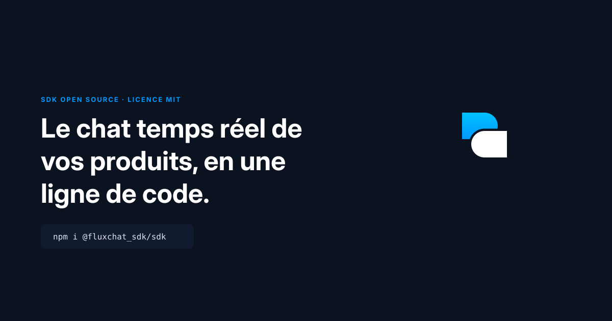

<div align="center">



# FluxChat SDK

**The official SDK, CLI &amp; embeddable chat widget for [FluxChat](https://fluxchat-corp.com).**

Drop a beautiful AI assistant into any product in minutes — with per-request context, a customizable persona, and full knowledge-base control.

[](https://www.npmjs.com/package/@fluxchat_sdk/sdk)
[](./LICENSE)
[](./dist/index.d.ts)
[](https://nodejs.org)

[Dashboard](https://fluxchat-corp.com) &nbsp;·&nbsp; [API](https://api.fluxchat-corp.com) &nbsp;·&nbsp; [Benflux](https://benflux-corp.com)

</div>

---

## Features

- **Ask API** — send messages and get high-quality answers from your assistant.
- **Per-request context** — inject real-time data (cart, user, page) treated as a *priority source of truth*, above the knowledge base.
- **Persona** — set the assistant name, tone, and style rules per organization.
- **Knowledge base** — create, update and delete articles with a scoped API key.
- **Human handoff** — hand a visitor to a real agent and keep the conversation in the same thread: ticket, polling, agent replies. No account, no "we'll e-mail you".
- **Embeddable widget** — a polished, fully customizable chat bubble for any website.
- **CLI** — talk to your bot and manage knowledge from the terminal.
- **Universal** — ESM + CJS + TypeScript types, zero-config.
- **Eleven stacks** — TS/JS, React, Vue, React Native, Flutter, Python, PHP, Go, Swift, Kotlin, .NET, all speaking the same API.

---

## Install

```bash
npm install @fluxchat_sdk/sdk
# or
pnpm add @fluxchat_sdk/sdk
# or
yarn add @fluxchat_sdk/sdk
```

> Requires Node.js **18+** (uses the global `fetch`). The widget runs in any modern browser.

### Other languages

The same API, idiomatic in each stack. Every client speaks API v2, unwraps the
`{ success, data }` envelope, maps errors to typed exceptions, and ships the
human-handoff surface (`escalate` / `thread` / `reply`).

| Stack | Package | Source | Install |
| ----- | ------- | ------ | ------- |
| **TypeScript / JavaScript** | `@fluxchat_sdk/sdk` | [`src/`](src) | `npm i @fluxchat_sdk/sdk` |
| **React** | same package | [`src/react`](src/react) | `import { FluxChatWidget } from '@fluxchat_sdk/sdk/react'` |
| **Vue** | same package | [`src/vue`](src/vue) | `import { FluxChatWidget } from '@fluxchat_sdk/sdk/vue'` |
| **React Native** | `@fluxchat/react-native` | [`sdk/react-native`](sdk/react-native) | `npm i @fluxchat/react-native` |
| **Dart / Flutter** | `fluxchat_sdk` | [`sdk/dart`](sdk/dart) | `dart pub add fluxchat_sdk` |
| **Python** | `fluxchat` | [`sdk/python`](sdk/python) | `pip install fluxchat` |
| **PHP** | `fluxchat/sdk` | [`sdk/php`](sdk/php) | `composer require fluxchat/sdk` |
| **Go** | `fluxchat` | [`sdk/go`](sdk/go) | `go get github.com/benflux-company/fluxchat-sdk/sdk/go` |
| **Swift** | `FluxChat` | [`sdk/swift`](sdk/swift) | Swift Package Manager |
| **Kotlin / JVM** | `com.fluxchat:sdk` | [`sdk/kotlin`](sdk/kotlin) | Gradle |
| **.NET / C#** | `FluxChat` | [`sdk/dotnet`](sdk/dotnet) | `dotnet add package FluxChat` |

Every client defaults to `https://api.fluxchat-corp.com/api/v2` — **production**.
Pass `baseUrl` explicitly to target dev.

---

## Quickstart

### 1. SDK

```ts
import { FluxChat } from '@fluxchat_sdk/sdk';

const fluxchat = new FluxChat({
  apiKey: process.env.FLUXCHAT_API_KEY!, // from your FluxChat dashboard
});

const { reply } = await fluxchat.ask({
  message: 'Quel est le statut de ma commande ?',
  context: 'Commande #1234 — expédiée le 3 juin, livraison prévue le 6 juin.',
});

console.log(reply);
```

### 2. CLI

```bash
export FLUXCHAT_API_KEY="fc_prod_your_key"

fluxchat test
fluxchat ask "Bonjour !" --context "Client VIP, panier de 3 articles."
```

### 3. Widget (one snippet)

```html
<script src="https://unpkg.com/@fluxchat_sdk/sdk/dist/widget.global.js"></script>
<script>
  FluxChatWidget.init({
    apiKey: 'fc_prod_your_key',
    clientName: 'Acme Bank',
    assistantName: 'Léa',
    primaryColor: '#4f46e5',
  });
</script>
```

---

## Widget

A floating chat bubble that looks great out of the box and is **fully themeable**.

```text
                                   +---------------------------+
                                   |  (L)  Léa               X |
                                   |       Acme Bank           |
                                   +---------------------------+
                                   |  Bonjour, comment puis-je |
                                   |  vous aider ?             |
                                   |                           |
                                   |       Quel est mon solde ?|
                                   |  Votre solde est de 4250 €|
                                   +---------------------------+
                                   |  Écrivez votre message… > |
                                   |     Propulsé par Benflux  |
                                   +---------------------------+
```

### Embed options

**A — Script tag (any site, no build step):**

```html
<script src="https://unpkg.com/@fluxchat_sdk/sdk/dist/widget.global.js"></script>
<script>
  const widget = FluxChatWidget.init({ apiKey: 'fc_prod_your_key' });
  // widget.open(); widget.close(); widget.send('Hi'); widget.destroy();
</script>
```

**B — Bundler / framework (React, Vue, Svelte…):**

```ts
import { init } from '@fluxchat_sdk/sdk/widget';

const widget = init({
  apiKey: import.meta.env.VITE_FLUXCHAT_API_KEY,
  clientName: 'Acme Bank',
  assistantName: 'Léa',
});
```

**C — React component (recommended for React/Next.js/Vite/CRA apps):**

Instead of the IIFE widget, build a native React component. This gives you full access to React context (auth, store) to inject user-specific data.

Read your API key from the env variable that matches your framework:

| Framework | Env variable prefix | Example |
|-----------|--------------------|---------------------------------|
| Vite | `VITE_` | `VITE_FLUXCHAT_API_KEY` |
| Next.js | `NEXT_PUBLIC_` | `NEXT_PUBLIC_FLUXCHAT_API_KEY` |
| CRA | `REACT_APP_` | `REACT_APP_FLUXCHAT_API_KEY` |
| Node / custom | any name | `FLUXCHAT_API_KEY` |

```tsx
// components/FluxChatWidget.tsx
import { useState, useRef, useCallback } from 'react'
import ReactMarkdown from 'react-markdown'
import remarkGfm from 'remark-gfm'

// Adapt the env variable name to your framework (see table above)
const API_URL = process.env.NEXT_PUBLIC_FLUXCHAT_API_URL   // Next.js
            ?? import.meta.env?.VITE_FLUXCHAT_API_URL       // Vite
            ?? 'https://api.fluxchat-corp.com/api/v2'

const API_KEY = process.env.NEXT_PUBLIC_FLUXCHAT_API_KEY
            ?? import.meta.env?.VITE_FLUXCHAT_API_KEY
            ?? ''

function buildContext(conversationActive: boolean): string {
  const parts: string[] = []
  const w = globalThis as typeof globalThis & { fluxchatContext?: unknown }
  if (w.fluxchatContext) {
    try { parts.push(JSON.stringify(w.fluxchatContext)) } catch { /**/ }
  }
  if (document.title) parts.push(`Page: ${document.title}`)
  parts.push(`URL: ${globalThis.location.href}`)
  // DOM is only scraped on the first message — prevents page content from
  // polluting mid-conversation context
  if (!conversationActive) {
    const el = document.querySelector('main') ?? document.body
    const text = el?.innerText?.replace(/\s+/g, ' ').trim().substring(0, 2000)
    if (text) parts.push(`Content: ${text}`)
  }
  return parts.join('\n').substring(0, 8000)
}

export default function FluxChatWidget() {
  const [open, setOpen]       = useState(false)
  const [messages, setMessages] = useState([])
  const [input, setInput]     = useState('')
  const [loading, setLoading] = useState(false)
  const [convId, setConvId]   = useState(null)
  const conversationStarted   = useRef(false)

  const send = useCallback(async () => {
    if (!input.trim() || loading || !API_KEY) return
    const text = input.trim()
    setMessages(p => [...p, { id: Date.now().toString(), role: 'user', content: text }])
    setInput('')
    setLoading(true)
    try {
      const context = buildContext(conversationStarted.current)
      conversationStarted.current = true
      const res = await fetch(`${API_URL}/public/bot/ask`, {
        method: 'POST',
        headers: { 'Content-Type': 'application/json', 'X-API-Key': API_KEY },
        body: JSON.stringify({ message: text, conversationId: convId ?? undefined, context }),
      })
      const data = await res.json()
      const reply = data?.data?.reply ?? 'Sorry, I could not respond.'
      if (data?.data?.conversationId && !convId) setConvId(data.data.conversationId)
      setMessages(p => [...p, { id: (Date.now() + 1).toString(), role: 'assistant', content: reply }])
    } catch {
      setMessages(p => [...p, { id: (Date.now() + 1).toString(), role: 'assistant', content: 'Network error. Please retry.' }])
    } finally { setLoading(false) }
  }, [input, loading, convId])

  if (!API_KEY) return null
  // ... your JSX (floating button, chat window, ReactMarkdown for bot replies)
}
```

Mount it at the root of your app so it renders on every page:

```tsx
// App.tsx or layout.tsx
export default function App() {
  return (
    <AuthProvider>
      <BrowserRouter>
        <Routes>...</Routes>
        <FluxChatContextInjector />  {/* see window.fluxchatContext section below */}
        <FluxChatWidget />
      </BrowserRouter>
    </AuthProvider>
  )
}
```

### Customization

| Option           | Type                    | Default                    | Description                                       |
| ---------------- | ----------------------- | -------------------------- | ------------------------------------------------- |
| `apiKey`         | `string` *(required)*   | —                          | Organization API key.                             |
| `baseUrl`        | `string`                | FluxChat API               | Override the API endpoint.                        |
| `clientName`     | `string`                | `''`                       | Your brand name, shown in the header.             |
| `assistantName`  | `string`                | `'Assistant'`              | The assistant's display name + avatar initial.    |
| `headerSubtitle` | `string`                | `'En ligne'`               | Subtitle under the name (when no `clientName`).   |
| `avatarUrl`      | `string`                | —                          | Avatar image (falls back to the initial).         |
| `logoUrl`        | `string`                | —                          | Logo image used in the header avatar.             |
| `primaryColor`   | `string`                | `'#4f46e5'`                | Brand color for header, bubbles and buttons.      |
| `theme`          | `'light' \| 'dark'`     | `'light'`                  | Color theme.                                      |
| `position`       | `'right' \| 'left'`     | `'right'`                  | Launcher corner.                                  |
| `radius`         | `number`                | `20`                       | Panel border radius (px).                         |
| `greeting`       | `string`                | `'Bonjour, comment…'`      | First assistant message.                          |
| `placeholder`    | `string`                | `'Écrivez votre message…'` | Input placeholder.                                |
| `launcherLabel`  | `string`                | `'Discuter'`               | Launcher tooltip / aria-label.                    |
| `context`        | `string`                | —                          | Static context sent with **every** message.       |
| `openOnLoad`     | `boolean`               | `false`                    | Open the panel automatically.                     |
| `showBranding`   | `boolean`               | `true`                     | Show the "Powered by Benflux" footer.             |
| `target`         | `string \| HTMLElement` | `document.body`            | Where to mount the widget.                        |
| `autoContext`    | `boolean`               | `true`                     | Inject the current page (title, URL, DOM text, `window.fluxchatContext`) into every message. |
| `autoCapture`    | `boolean`               | `true`                     | Passively capture every page visited and store it so the bot knows your entire site. Works on any stack — static HTML, WordPress, React/Vue SPAs. |
| `platformApi`    | `{ baseUrl: string; authTokenKeys?: string[] }` | — | Base URL of your platform's REST API. The widget auto-discovers GET endpoints and queries relevant ones per message to enrich answers with live data. |

Returns a `WidgetInstance`: `open()`, `close()`, `toggle()`, `send(message)`, `destroy()`.

---

## Zero-config site intelligence

From v0.1.5, the widget learns your entire site automatically — no admin setup, no crawl commands, no KB imports.

### autoCapture (default: true)

Every page the user visits is captured and sent to FluxChat. The bot can immediately answer questions about any content on your site.

```js
// Works out of the box — nothing to configure
FluxChatWidget.init({ apiKey: 'fc_live_xxx' });

// User visits /about → captured
// User visits /sermons → captured
// User asks "what are the latest sermons?" → bot answers from captured content
```

Works on **static HTML, WordPress, React Router, Vue Router, Angular, Next.js** — any site, with or without an API. SPA navigation (pushState / replaceState / popstate / hashchange) is intercepted automatically.

Set `autoCapture: false` only if you populate the KB yourself.

### platformApi — live data from your own API

The widget can query your platform's REST API in real time to answer questions that require fresh data (orders, events, sermons, products, etc.).

```js
FluxChatWidget.init({
  apiKey: 'fc_live_xxx',
  platformApi: { baseUrl: 'https://api.my-app.com' },
  // Auth token is read from localStorage automatically
  // (tries: member_token, admin_token, token, auth_token, access_token)
});
```

The widget fetches your OpenAPI/Swagger spec on init, scores all GET endpoints against each user question, calls the top matches, and appends the results to the context before sending to FluxChat.

No manual intent/action setup. No configuration. If your API has a spec, the bot uses it.

---

## SDK reference

### Create a client

```ts
import { FluxChat } from '@fluxchat_sdk/sdk';

const fluxchat = new FluxChat({
  apiKey: 'fc_prod_your_key',            // X-API-Key auth (public bot + bot:write KB)
  // token: 'eyJ...',           // OR a JWT for admin operations
  // baseUrl: 'https://dev-api.fluxchat-corp.com/api/v2', // override for local/dev testing — defaults to production
  organizationId: 'org-uuid',   // default org for knowledge/config helpers
});
```

### `ask(options)`

```ts
const res = await fluxchat.ask({
  message: 'Comment retourner un article ?',
  context: 'Politique de retour: 30 jours, gratuit pour les membres Premium.',
  conversationId: undefined,    // omit for a stateless one-off answer
});
// res.reply, res.conversationId, res.intent, res.confidence
```

### `testKey()`

```ts
const { organizationId, scopes } = await fluxchat.testKey();
```

### Knowledge base

```ts
// Writes need an API key with the `bot:write` scope:
const article = await fluxchat.knowledge.create({
  title: 'Horaires',
  content: 'Lun–Ven 9h–18h.',
  category: 'general',
  keywords: ['horaires', 'ouverture'],
});

await fluxchat.knowledge.update(article.id, { content: 'Lun–Ven 8h–19h.' });
await fluxchat.knowledge.remove(article.id);

// Reads need a JWT token:
const all = await fluxchat.knowledge.list();
const one = await fluxchat.knowledge.get(article.id);
```

### Persona config

```ts
await fluxchat.config.update({
  assistantName: 'Léa',
  tone: 'chaleureux et concis',
  styleRules: 'Tutoie le client, évite le jargon.',
  captureTrainingData: false,
});

const cfg = await fluxchat.config.get();
```

### Human handoff & support thread

When the bot can't help, hand the visitor to a human. This creates a real
support ticket in the organization's dashboard — and, unlike a contact form,
the conversation **stays open in the same thread**: the visitor polls it, the
agent answers into it.

```ts
// 1. Hand off. Pass the same sessionId you use with ask() and everything the
//    bot already said is copied into the ticket, so the agent has context.
const { ticketId } = await fluxchat.support.escalate({
  name: 'Jordan Mbeki',
  email: 'jordan@example.com',
  message: 'Mon virement est bloqué depuis hier.',
  sessionId: mySessionId,
});

// 2. Follow the thread. Keep { ticketId, email } — the e-mail is what proves
//    the ticket is theirs (no account, no token).
const thread = await fluxchat.support.thread(ticketId, 'jordan@example.com');
thread.messages.forEach((m) => console.log(m.role, m.content)); // bot | visitor | agent
if (thread.agentConnected) console.log(`${thread.agentName} is answering`);

// 3. Let them reply into it.
await fluxchat.support.reply({
  ticketId,
  email: 'jordan@example.com',
  content: 'La référence est 4821.',
});
```

Notes worth knowing:

- **Ownership is the e-mail.** A wrong e-mail and a non-existent ticket both
  return **404**, deliberately — a guessed ticket id reveals nothing. The
  lookup is also scoped to the organization behind your API key.
- **Poll, don't push.** There is no socket on the public surface. 5s is the
  cadence the official widget uses and what the route's rate limit is sized
  for (60 reads/min, 30 replies/min, 5 escalations/min).
- **Statuses**: `open` → `in_progress` → `resolved` → `closed`. A reply to a
  `resolved` ticket reopens it; a `closed` one refuses the write (**403**)
  rather than swallowing a message nobody will read.
- Requires the organization's plan to include `supportTickets` (**403**
  otherwise), and an API running api-chat-integration ≥ the support-thread
  release.

The embeddable widget does all of this for you — see [`humanHandoff`](#embed-options).

### Errors

Every failure is a typed subclass of `FluxChatError`:

```ts
import { FluxChatApiError, FluxChatConfigError, FluxChatNetworkError } from '@fluxchat_sdk/sdk';

try {
  await fluxchat.knowledge.create({ title: 'x', content: 'y' });
} catch (err) {
  if (err instanceof FluxChatApiError) {
    console.error(err.status, err.message); // e.g. 403 "API key missing required scope(s): bot:write"
  }
}
```

---

## CLI reference

```bash
fluxchat [global options] <command>
```

**Global options** (or env vars): `--api-key` (`FLUXCHAT_API_KEY`), `--token` (`FLUXCHAT_TOKEN`), `--base-url` (`FLUXCHAT_BASE_URL`), `--org` (`FLUXCHAT_ORG_ID`), `--json`.

| Command                                | Description                                  |
| -------------------------------------- | -------------------------------------------- |
| `fluxchat test`                        | Verify the API key and show its scopes.      |
| `fluxchat ask <message> [-c ctx]`      | Send a message (with optional `--context`).  |
| `fluxchat kb list`                     | List knowledge articles *(needs `--token`)*. |
| `fluxchat kb get <id>`                 | Show one article *(needs `--token`)*.        |
| `fluxchat kb create --title --content` | Create an article *(`bot:write`)*.           |
| `fluxchat kb update <id> [...]`        | Update an article *(`bot:write`)*.           |
| `fluxchat kb delete <id>`              | Delete an article *(`bot:write`)*.           |
| `fluxchat config get`                  | Show the persona config.                     |
| `fluxchat config set [...]`            | Update the persona *(needs `--token`)*.      |
| `fluxchat support escalate [...]`      | Hand a visitor off to a human.               |
| `fluxchat support thread <id> --email` | Read that visitor's ticket thread.           |
| `fluxchat support reply <id> [...]`    | Post the visitor's reply into the ticket.    |

```bash
# Examples
fluxchat ask "Quels sont vos tarifs ?" --json
fluxchat kb create --title "FAQ livraison" --content "Livraison sous 48h." --keywords "livraison,délai"
fluxchat config set --name "Léa" --tone "amical" --token "$JWT"

# Human handoff, end to end
fluxchat support escalate --name "Jordan" --email jordan@example.com \
  --message "Mon virement est bloqué" --session "$SESSION_ID"
fluxchat support thread t_abc123 --email jordan@example.com
fluxchat support reply t_abc123 --email jordan@example.com --message "La référence est 4821"
```

---

## Popular tasks

<details>
<summary><b>Inject the logged-in user as context</b></summary>

```ts
await fluxchat.ask({
  message: 'Ai-je des factures impayées ?',
  context: `Utilisateur: ${user.name} (id ${user.id}). Factures impayées: ${unpaid.length}.`,
});
```
</details>

<details>
<summary><b>Sync your FAQ into the knowledge base (CI script)</b></summary>

```ts
import { FluxChat } from '@fluxchat_sdk/sdk';
const fx = new FluxChat({ apiKey: process.env.FLUXCHAT_API_KEY!, organizationId: process.env.ORG! });

for (const item of faq) {
  await fx.knowledge.create({ title: item.q, content: item.a, category: 'support' });
}
```
</details>

<details>
<summary><b>Brand the widget to match your site</b></summary>

```js
FluxChatWidget.init({
  apiKey: 'fc_prod_your_key',
  clientName: 'Acme Bank',
  assistantName: 'Léa',
  primaryColor: '#0a7c4a',
  theme: 'dark',
  position: 'left',
  greeting: 'Une question sur votre compte ?',
});
```
</details>

<details>
<summary><b>Open the widget from your own button</b></summary>

```js
const widget = FluxChatWidget.init({ apiKey: 'fc_prod_your_key' });
document.querySelector('#help').addEventListener('click', () => widget.open());
```
</details>

<details>
<summary><b>Stateless one-off answer (no conversation stored)</b></summary>

```ts
const { reply, conversationId } = await fluxchat.ask({ message: 'Bonjour' });
// conversationId === "" → nothing was persisted server-side
```
</details>

---

## Injecting user context (`window.fluxchatContext`)

By default the React component widget captures the page title, URL, and visible DOM text. It knows nothing about the logged-in user, their organisation, or page-specific data.

Set `window.fluxchatContext` (or `globalThis.fluxchatContext`) **before** the user sends their first message. The widget reads it automatically on each request.

### Schema

```ts
window.fluxchatContext = {
  // Persistent — set at root layout
  user: {
    name: 'Alice Martin',
    email: 'alice@example.com',
    role: 'admin',            // or 'member', 'owner', etc.
  },
  org: {
    name: 'Acme Bank',
    id: 'org-uuid',
  },

  // Page-specific — set per page, removed on unmount
  billing: {
    plan: 'pro',
    messagesUsed: 1240,
    messagesLimit: 5000,
  },
}
```

### Framework examples

**React / Vite — inject at root (inside your auth provider):**

```tsx
function FluxChatContextInjector() {
  const { user, org } = useAuth()   // adapt to your auth hook

  useEffect(() => {
    const w = globalThis as typeof globalThis & { fluxchatContext?: Record<string, unknown> }
    if (user) {
      w.fluxchatContext = {
        user: { name: user.name, email: user.email, role: user.role },
        org:  { name: org.name, id: org.id },
      }
    } else if (w.fluxchatContext) {
      const { user: _u, org: _o, ...rest } = w.fluxchatContext
      w.fluxchatContext = rest
    }
  }, [user, org])

  return null
}
```

**Next.js — inject in root `layout.tsx`:**

```tsx
'use client'
import { useEffect } from 'react'
import { useSession } from 'next-auth/react'   // or your own auth

export function FluxChatContextInjector() {
  const { data: session } = useSession()

  useEffect(() => {
    const w = window as Window & { fluxchatContext?: Record<string, unknown> }
    if (session?.user) {
      w.fluxchatContext = {
        user: { name: session.user.name, email: session.user.email },
      }
    }
  }, [session])

  return null
}
```

**Page-specific data (any framework) — merge and clean up on unmount:**

```tsx
useEffect(() => {
  const w = globalThis as typeof globalThis & { fluxchatContext?: Record<string, unknown> }
  w.fluxchatContext = { ...(w.fluxchatContext ?? {}), billing: quotaData }
  return () => {
    if (w.fluxchatContext) {
      const { billing: _b, ...rest } = w.fluxchatContext
      w.fluxchatContext = rest
    }
  }
}, [quotaData])
```

> **Important rules**
> - Set persistent data (user, org) at the root layout — not per-page — to avoid race conditions.
> - Always merge page-specific data; never overwrite the full object.
> - Clean up page-specific keys on component unmount so stale data doesn't bleed across routes.
> - DOM scraping is disabled after the first message — `fluxchatContext` is the reliable source for all subsequent turns.

---

## API versions

The FluxChat API is versioned. This SDK and the widget target **v2** by default.

| Version | Base URL | Notes |
| ------- | ------------------------------------------ | ----------------------------------------------- |
| **v2** *(default)* | `https://api.fluxchat-corp.com/api/v2` | Per-request `context`, stateless public asks. |
| **v1** *(legacy)*  | `https://api.fluxchat-corp.com/api/v1` | Stable, backward-compatible. **Does not accept `context`.** |

Pin a version explicitly via `baseUrl` (SDK) or the `baseUrl` widget option. Passing
`context` against **v1** returns `400` — use v2 for context-aware answers.

For local/dev testing, point `baseUrl` at `https://dev-api.fluxchat-corp.com/api/v{1,2}`
instead — the dev cluster, not production.

---

## Authentication &amp; scopes

| Operation                                  | Auth                             |
| ------------------------------------------ | -------------------------------- |
| `ask`, `testKey`, widget                   | API key (`X-API-Key`)            |
| Knowledge **write** (create/update/delete) | API key with `bot:write` scope   |
| Knowledge **read**, persona `config`       | JWT (admin) token                |

Create and manage API keys from the **[FluxChat dashboard](https://fluxchat-corp.com)** → Organization settings → API Keys.

---

## Contributors

FluxChat's SDKs are built by the Benflux team and its contributors.

| | Contribution |
| --- | --- |
| **[@benbaruka](https://github.com/benbaruka)** (Ben Ickah) | Core TypeScript SDK, CLI, embeddable widget, human handoff and support thread, Dart/Flutter SDK |
| **[@benjaminmugangu](https://github.com/benjaminmugangu)** | Python, PHP, Swift, Kotlin, .NET and React Native SDKs |
| **Baruka David** | Go SDK |

Adding a stack? [`CONTRIBUTING.md`](CONTRIBUTING.md) has the required checklist
— every client must speak API v2, unwrap the `{ success, data }` envelope, map
errors to typed exceptions, default to the **production** base URL, and
implement the handoff surface (`escalate` / `thread` / `reply`).

---

## Development

```bash
npm install
npm run build      # tsup → ESM + CJS + d.ts + CLI + widget
npm test           # vitest
npm run typecheck
```

---

<div align="center">

A product by **[Benflux](https://benflux-corp.com)** · MIT Licensed

</div>
